# Documentation of the different training runs

This file records every training run on Fox: the plume agent in runs 1–3 and the HRL meta agent from run 4 on (see [HRL meta agent](#hrl-meta-agent)). For each run it gives the settings, what changed from the previous run and why, and the results. Use it to see how a parameter change affects training.

- **Run folders:** `../trained-agents/<run>` on this machine. On Fox the training scripts write to `../trained-agents/<run>`.
- **Run names:** `<ALG>_<tag>_<Slurm job ID>`, set by [fox_train.sh](../fox_train.sh). One `sbatch fox_train.sh <tag>` starts DQN, PPO and SAC as one array job, so all three share the job ID.
- **Copies in git:** [training_runs/](training_runs/) holds `training_stats.png` and `training_config.json` for each run, and `resume_log.txt` for runs that were resumed after a failed job. The SVG plots, the models and the stats pickles stay in `../trained-agents`.
- **Why the methods are set up the way they are:** [comparing_training_methods.md](comparing_training_methods.md).

## How to read the results

The plots come from [training_data_visualiser.py](../HUGIN_gym/evaluation/training_data_visualiser.py). The numbers tables come from [summarise_training_stats.py](../HUGIN_gym/evaluation/summarise_training_stats.py):

```bash
.venv/bin/python -m HUGIN_gym.evaluation.summarise_training_stats ../trained-agents/<run> [<run> ...] --last 1000
```

| Metric | Meaning |
|---|---|
| Total reward | Sum of the rewards in the episode. |
| Episode length | Steps in the episode. The step limit is the run's episode length setting. |
| Visited (%) | Share of the map the agent visited by the end of the episode. |
| Plume coverage (%) | Share of the true above-threshold cells the agent visited by the end of the episode. In the plots this panel is labelled "Steps Above Threshold (%)". |
| Ended early (%) | Share of episodes that ended before the step limit. For the plume agent this only happens when it reaches its plume coverage goal (100 %, +40 reward). With the GP on, the goal is checked against the GP's estimate of the plume, so it can differ from the true coverage. |

- The numbers are mean ± std over the last 1,000 training episodes of a run. For repeated runs, the bold row gives the mean ± std of the run means.
- In GP runs, 1–15 % of the episodes do not report the true plume coverage, so that column covers slightly different episodes than the others.
- Training episodes include exploration (random actions for DQN, sampled actions for PPO and SAC). Use these numbers to see how a change affects one algorithm. Do not use them to rank the algorithms; that needs the deterministic evaluation described in [comparing_training_methods.md](comparing_training_methods.md#3-how-to-compare).
- In the plots, the "Steps Around Threshold (%)" panel is always empty for the plume agent. The rightmost panel shows the reward at each step of every 10th episode; the spikes to 40 are the goal bonus.

## Overview

| # | Tag | Slurm job IDs | Started | Code | Main change | Status |
|---|---|---|---|---|---|---|
| 1 | `gp_230steps` | 4218364 | 2026-09-24 22:01 | `f220184` | First runs of all three algorithms on Fox | Finished |
| 2 | `compare` | 4223550, 4223553, 4223557 | 2026-09-26 13:35–13:49 | `961f7a2` | Same task, budget and network size for all three algorithms; start near the plume; random plume size; less DQN exploration. 3 repeats | Finished |
| 3 | `compare_100M` | 4259604, 4259607, 4259610; resumed as 4272086, 4272088, 4272091 | 2026-10-04 22:31 – 2026-10-05 05:05 | `10e4023`; resumed with `bf7e7fc` | 10× the steps, 24 envs, 460-step episodes, 128 × 128 networks. 3 repeats | Finished; 8 of 9 runs resumed after a full disk quota |
| 4 | `untuned` (HRL) | 4363368; resumed twice | 2026-10-28 15:13 | `56ba1c7` | First training of the HRL meta agent, with the settings from the thesis code | Running; hit the 12 h limit twice and was resumed |
| 5 | `duration`, `duration_mean`, `minimal`, `minimal_values`, `minimal_values_duration` (HRL) | Not submitted yet | – | Not committed yet | The meta agent chooses how many steps a sub-agent runs; smaller meta states; sub-agent value estimates | Planned for 2026-10-29 |

"Started" is `RUN_INFO.timestamp` in `training_config.json`. "Code" is the last commit before the run started. From run 3 on, it is the commit checked out on Fox when the job started (`git reflog --date=iso` on Fox).

## Settings shared by runs 1–3 (plume agent)

- **Agent:** plume agent (`AGENT_TYPE = "PLUME"`) with the feature extractor `AgentPlumeExplore` ([agent2_plume_explore.py](../HUGIN_gym/agents/feature_extractor/agent2_plume_explore.py)). It turns 108 inputs into 128 features (ReLU): plume and map coverage, position and heading, a 7 × 7 visited patch, a 7 × 7 plume patch, and the distance from the maximum. The hidden layers after it differ per run (see the tables).
- **Observation keys:** DQN and SAC keep 7 keys (`obs_state`, `visited_maps_downsampled`, `GT_c_over_threshold_maps_downsampled`, `local_GT`, `plume_coverage`, `space_coverage`, `distance_from_max`); PPO keeps 5 (without the two downsampled maps). The feature extractor does not read the downsampled maps, so all three get the same inputs.
- **Environment** ([HUGIN_env.py](../HUGIN_gym/envs/HUGIN_env.py)): 2D map of 41 × 41 cells, one Gaussian gas source per episode at a random position, concentration threshold 0.3, 5 discrete actions (forward, up, down, left turn, right turn). SAC acts through [continuous_wrapper.py](../HUGIN_gym/envs/wrappers/continuous_wrapper.py), which maps one number in [−1, 1] to the 5 actions.
- **Goal:** accuracy goals [0.9, 1.0, 1.0], so the plume agent's goal is 100 % plume coverage.
- **Reward** ([agent2_plume.py](../HUGIN_gym/envs/core/rewards/agent2_plume.py), identical in all runs; each `training_config.json` stores the source under `REWARD_FUNCTION_SOURCE`): per step a −0.7 time penalty, + (newly covered above-threshold cells) / 6, and a turn penalty of up to −0.3. Reaching the goal gives +40 and ends the episode.
- **GP** ([GPWrapper.py](../HUGIN_gym/envs/wrappers/GPWrapper.py), RBF kernel, length scale 3.5): with the GP on, the agent's plume patch and plume coverage come from a Gaussian process fitted to its own measurements, and the reward and the goal check use that estimate. With the GP off, the agent sees the true plume.
- **Fox:** module `Python/3.12.3-GCCcore-13.3.0`, one math thread per process, one array task per algorithm.

## Run 1: `gp_230steps` (job 4218364)

- **Goal:** first training of the plume agent with DQN, PPO and SAC on Fox, as a baseline.
- **Submitted with:** `sbatch fox_train.sh gp_230steps`
- **Code:** `f220184` (2026-09-24). PPO used the `--paper` preset (`PAPER_CONFIG`).
- **Fox resources per algorithm:** 16 CPUs, 2 GB per CPU, 16 h limit.

> **The tag is misleading.** Only DQN trained with the GP and 230-step episodes. PPO and SAC trained without the GP and with 460-step episodes, which is a different and easier task. DQN also trained for 3× as many steps. The three algorithms in this run are therefore not comparable.

### Task and budget

| Setting | DQN | PPO | SAC |
|---|---|---|---|
| Script and preset | `train_DDQN.py` | `train_PPO.py --paper` | `train_SAC.py` |
| GP / `SUB_AGENT_TRAIN_ON_GP` | on / on | off / on (no effect without the GP) | off / off |
| Episode length (steps) | 230 | 460 | 460 |
| Total steps | 30M | 10M | 10M |
| Parallel envs | 12 | 12 | 12 |
| `gamma` | 0.9945 | 0.9975 | 0.997 |
| Hidden layers (SB3 defaults) | [64, 64] ReLU | pi [64, 64], vf [64, 64] Tanh | [256, 256] ReLU |
| Checkpoint every | 2M steps | 1M steps | 2M steps |
| Start position | anywhere on the map | anywhere on the map | anywhere on the map |
| Plume size | fixed, σ = 3.5 | fixed, σ = 3.5 | fixed, σ = 3.5 |
| Wall-clock time (approx.) | 14.4 h | 1.2 h | 6.8 h |

### Algorithm settings

| Setting | DQN | PPO | SAC |
|---|---|---|---|
| `learning_rate` | 1e-4 | 3e-4 | 5e-5 |
| `batch_size` | 128 | 1024 | 256 |
| Replay buffer | 800,000 | – | 900,000 |
| `learning_starts` | 400,000 | – | 100 (SB3 default) |
| `train_freq` / `gradient_steps` | 4 / 4 | – | 4 / 4 |
| Target network update | every 50,000 steps | – | every step, `tau` 0.01 |
| Exploration | ε from 1.0 to 0.05 over the first 80 % of the run (`exploration_fraction` 0.8) | `ent_coef` 0.01 | `ent_coef` auto |
| `n_steps` / `n_epochs` | – | 512 / 4 | – |
| `gae_lambda` / `clip_range` | – | 0.95 / 0.2 | – |
| `vf_coef` / `max_grad_norm` | – | 0.5 / 0.5 | – |

The `episode_stats_*.pkl` snapshots of this run were deleted on 2026-10-05 to save space. `training_stats.pkl` (all episodes) is kept.

### Results

Mean ± std over the last 1,000 training episodes:

| Run | Episodes | Total reward | Episode length | Visited (%) | Plume coverage (%) | Ended early (%) |
|---|---|---|---|---|---|---|
| `DQN_gp_230steps_4218364` | 149,661 | -57.2 ± 69.6 | 161.9 ± 65.4 | 28.5 ± 12.3 | 96.0 ± 17.5 | 62.4 |
| `PPO_gp_230steps_4218364` | 31,613 | -60.7 ± 91.3 | 151.0 ± 108.8 | 23.3 ± 12.1 | 98.9 ± 8.5 | 93.9 |
| `SAC_gp_230steps_4218364` | 50,301 | -83.8 ± 145.0 | 138.2 ± 115.5 | 14.5 ± 4.5 | 96.1 ± 18.7 | 92.1 |

**DQN** (GP on, 230 steps, 30M steps)

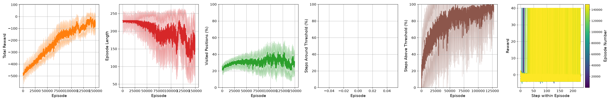

**PPO** (GP off, 460 steps, 10M steps)

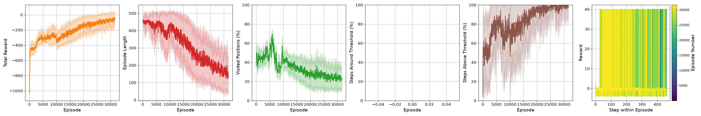

**SAC** (GP off, 460 steps, 10M steps)

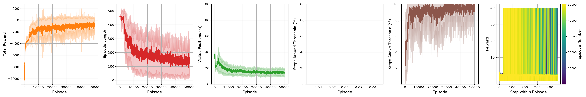

### Observations

- **DQN:** the reward rises slowly and steadily over the whole run, from about −500 to about −50 over 150k episodes. The episode length stays at the 230-step limit for the first ~30k episodes and is still noisy at the end. With `exploration_fraction` 0.8, ε only reaches its final 5 % after 24M of the 30M steps, so most of the run has many random actions.
- **PPO:** the episode length falls from 460 to about 150 and is still falling at the end, so the run had not converged after 10M steps. The share of the map visited falls from about 45 % to about 22 %. It was the fastest run (1.2 h).
- **SAC:** most of the gain happens in the first ~10k episodes. After that, the reward and the episode length level off at about −100 and 150 steps. It visits the smallest share of the map (about 15 %).

## Run 2: `compare` (jobs 4223550, 4223553, 4223557)

- **Goal:** a fair comparison of DQN, PPO and SAC: the same task, training budget and network size for all three, each with its own algorithm settings. Submitted three times with identical settings to see the spread between runs.
- **Submitted with:** `sbatch fox_train.sh compare` (3 times)
- **Code:** `961f7a2` (2026-09-26). PPO used the new `--compare` preset (`COMPARE_CONFIG`).
- **Fox resources per algorithm:** unchanged (16 CPUs, 2 GB per CPU, 16 h limit).

### What changed from run 1

| Change | Commit | Why |
|---|---|---|
| Start in a box around the plume (the plume's bounding box plus 3 cells) instead of anywhere on the map | `ac68318` | In the HRL setup the plume agent takes over near a plume, after the exploration agent has found it. |
| New plume size every episode: σ drawn from [2.0, 5.0] (plumes 5–15 cells wide) instead of a fixed σ = 3.5 | `ac68318` | Train on plumes of different sizes instead of one size. |
| GP on and 230-step episodes for all three (PPO and SAC had the GP off and 460 steps) | `858ee1e` | Same task for all. |
| 10M steps for all (DQN had 30M) | `858ee1e` | Same budget. |
| `gamma` 0.995 for all (was 0.9945 / 0.9975 / 0.997) | `858ee1e` | `gamma` defines what the agent optimizes, so it must be equal. |
| Hidden layers [64, 64] for all (SAC had [256, 256]) | `858ee1e` | Same network size. |
| Checkpoint every 1M steps for all | `858ee1e` | Checkpoints at the same step counts, for evaluation during training. |
| PPO: new `COMPARE_CONFIG` preset with `n_steps` 2048 (was 512 in `PAPER_CONFIG`) | `858ee1e`, `961f7a2` | A PPO preset with the GP on and 230 steps. |
| DQN `exploration_fraction` 0.8 → 0.2 | `cad73a3` | With 0.8, DQN acts mostly at random for most of the run; 0.1–0.3 is standard. |

> Many settings changed at once, so the difference between run 1 and run 2 cannot be traced to a single parameter.

### Task and budget

Values in bold changed from run 1.

| Setting | DQN | PPO | SAC |
|---|---|---|---|
| Script and preset | `train_DDQN.py` | `train_PPO.py` **`--compare`** | `train_SAC.py` |
| GP / `SUB_AGENT_TRAIN_ON_GP` | on / on | **on** / on | **on / on** |
| Episode length (steps) | 230 | **230** | **230** |
| Total steps | **10M** | 10M | 10M |
| Parallel envs | 12 | 12 | 12 |
| `gamma` | **0.995** | **0.995** | **0.995** |
| Hidden layers | [64, 64] ReLU | pi [64, 64], vf [64, 64] Tanh | **[64, 64]** ReLU |
| Checkpoint every | **1M steps** | 1M steps | **1M steps** |
| Start position | **near the plume** | **near the plume** | **near the plume** |
| Plume size | **σ random in [2.0, 5.0]** | **σ random in [2.0, 5.0]** | **σ random in [2.0, 5.0]** |
| Wall-clock time (approx., 3 runs) | 4.2–5.2 h | 2.8–7.4 h | 6.3–11.9 h |

### Algorithm settings

Values in bold changed from run 1.

| Setting | DQN | PPO | SAC |
|---|---|---|---|
| `learning_rate` | 1e-4 | 3e-4 | 5e-5 |
| `batch_size` | 128 | 1024 | 256 |
| Replay buffer | 800,000 | – | 900,000 |
| `learning_starts` | 400,000 | – | 100 (SB3 default) |
| `train_freq` / `gradient_steps` | 4 / 4 | – | 4 / 4 |
| Target network update | every 50,000 steps | – | every step, `tau` 0.01 |
| Exploration | ε from 1.0 to 0.05 over the first **20 %** of the run (`exploration_fraction` **0.2**) | `ent_coef` 0.01 | `ent_coef` auto |
| `n_steps` / `n_epochs` | – | **2048** / 4 | – |
| `gae_lambda` / `clip_range` | – | 0.95 / 0.2 | – |
| `vf_coef` / `max_grad_norm` | – | 0.5 / 0.5 | – |

### Results

Mean ± std over the last 1,000 training episodes of each run:

| Run | Episodes | Total reward | Episode length | Visited (%) | Plume coverage (%) | Ended early (%) |
|---|---|---|---|---|---|---|
| `DQN_compare_4223550` | 55,330 | -94.6 ± 80.0 | 177.8 ± 78.6 | 35.2 ± 17.1 | 93.6 ± 20.6 | 36.9 |
| `DQN_compare_4223553` | 55,211 | -110.1 ± 69.3 | 192.2 ± 67.4 | 29.1 ± 12.0 | 90.0 ± 24.9 | 31.3 |
| `DQN_compare_4223557` | 55,815 | -88.0 ± 75.0 | 171.2 ± 78.0 | 28.7 ± 15.3 | 92.5 ± 22.0 | 44.3 |
| **DQN_compare (mean of 3 runs)** |  | **-97.6 ± 9.2** | **180.4 ± 8.8** | **31.0 ± 3.0** | **92.0 ± 1.5** | **37.5 ± 5.3** |
| `PPO_compare_4223550` | 83,262 | -2.8 ± 49.8 | 77.4 ± 55.1 | 9.0 ± 4.0 | 99.4 ± 5.5 | 96.2 |
| `PPO_compare_4223553` | 83,533 | -6.0 ± 44.9 | 81.5 ± 57.8 | 9.3 ± 3.7 | 99.6 ± 3.4 | 95.5 |
| `PPO_compare_4223557` | 74,930 | -5.4 ± 42.8 | 83.2 ± 58.7 | 10.0 ± 4.5 | 99.5 ± 5.5 | 95.6 |
| **PPO_compare (mean of 3 runs)** |  | **-4.7 ± 1.4** | **80.7 ± 2.4** | **9.4 ± 0.4** | **99.5 ± 0.1** | **95.8 ± 0.3** |
| `SAC_compare_4223550` | 52,335 | -76.0 ± 92.8 | 140.1 ± 84.0 | 9.5 ± 5.5 | 91.5 ± 25.6 | 61.9 |
| `SAC_compare_4223553` | 60,498 | -69.2 ± 110.7 | 117.7 ± 75.9 | 10.9 ± 6.8 | 93.7 ± 22.4 | 80.2 |
| `SAC_compare_4223557` | 51,528 | -85.4 ± 92.9 | 142.0 ± 79.5 | 12.3 ± 8.8 | 92.0 ± 24.2 | 66.7 |
| **SAC_compare (mean of 3 runs)** |  | **-76.9 ± 6.6** | **133.3 ± 11.1** | **10.9 ± 1.2** | **92.4 ± 0.9** | **69.6 ± 7.7** |


**DQN**

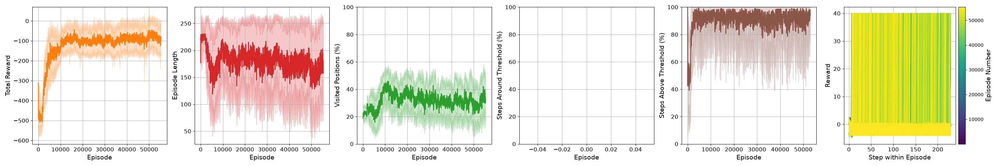
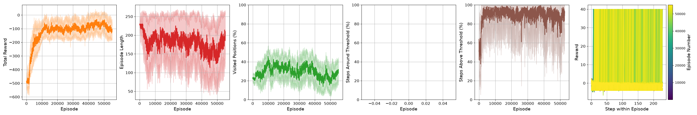
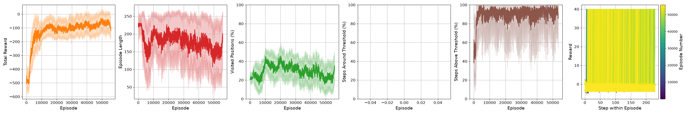

**PPO**

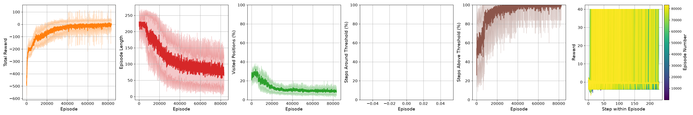
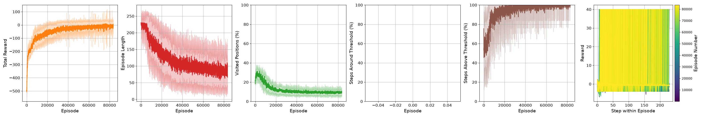
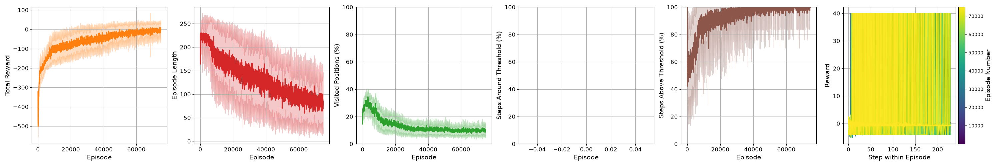

**SAC**

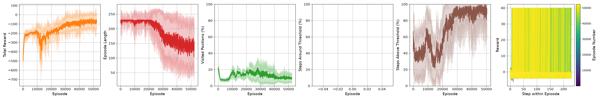
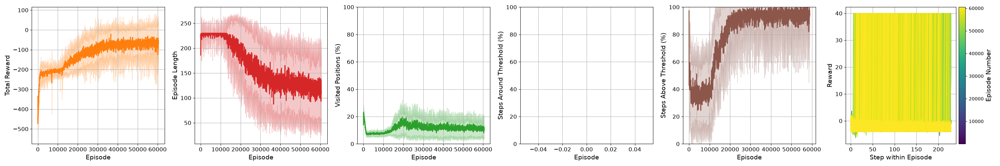
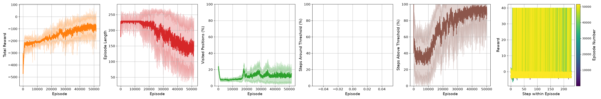

### Observations

- **Spread between repeats:** small for PPO (the run means of the reward range from −6.0 to −2.8), larger for SAC ("ended early" ranges from 62 % to 80 %).
- **DQN:** the reward climbs fast in the first ~10k episodes (ε reaches 0.05 after 2M steps, compared with 24M in run 1), then stays at about −100 for the remaining ~45k episodes. The true plume coverage is high (92 %), but only 37 % of the episodes reach the goal and end early. It visits about 30 % of the map, about 3× more than PPO and SAC.
- **PPO:** the reward rises steadily to about −5. Episodes get shorter (about 80 steps), and 96 % end early with 99.5 % plume coverage while visiting only about 9 % of the map. The reward is still rising slightly and the episode length still falling at 10M steps.
- **SAC:** the episode length stays at the 230-step limit for the first 12k–22k episodes, and the plume coverage drops to 20–40 % during this phase. Then it learns to finish episodes. When this happens differs between repeats (about 12k episodes in `4223553`, about 22k in `4223550`). It ends at about −77 reward, with 70 % of the episodes ending early.
- **Wall-clock time:** SAC took the longest (6.3–11.9 h), then DQN (4.2–5.2 h) and PPO (2.8–7.4 h). The times vary between repeats on the same resources, so treat them as rough.

## Run 3: `compare_100M` (jobs 4259604, 4259607, 4259610)

- **Goal:** the run 2 setup with 10× the training budget, longer episodes and larger networks.
- **Submitted with:** `sbatch fox_train.sh compare_100M` (3 times)
- **Code:** `10e4023` (2026-10-04), pulled on Fox one minute before the first submission. On top of `d80a55e`, it only deletes older episode stats snapshots, so the training settings are those of `d80a55e`. The resumed runs used `bf7e7fc` (see [Failure and resume](#failure-and-resume)).
- **Fox resources per algorithm:** 28 CPUs, 2 GB per CPU (56 GB), 60 h limit. The Slurm log of the DQN job `4259604_0` reports a memory peak of 29.3 GiB and an average CPU use of 20.5 %.
- **Status:** finished. 8 of the 9 runs failed after about 24 h because the disk quota was full, and were resumed from their newest checkpoint.

### What changed from run 2

| Change | Commit |
|---|---|
| 100M steps for all (was 10M) | `4a452da` |
| 24 parallel envs (was 12) | `4a452da` |
| 460-step episodes for all (was 230) | `4a452da` |
| Hidden layers [128, 128] for all (was [64, 64]) | `4a452da` |
| Checkpoint every 10M steps (was 1M) | `4a452da` |
| Fox: 28 CPUs, 56 GB, 60 h (was 16 CPUs, 32 GB, 16 h) | `d80a55e` |

### Task and budget

Values in bold changed from run 2. The algorithm settings are unchanged from run 2.

| Setting | DQN | PPO | SAC |
|---|---|---|---|
| Script and preset | `train_DDQN.py` | `train_PPO.py --compare` | `train_SAC.py` |
| GP / `SUB_AGENT_TRAIN_ON_GP` | on / on | on / on | on / on |
| Episode length (steps) | **460** | **460** | **460** |
| Total steps | **100M** | **100M** | **100M** |
| Parallel envs | **24** | **24** | **24** |
| `gamma` | 0.995 | 0.995 | 0.995 |
| Hidden layers | **[128, 128]** ReLU | **pi [128, 128], vf [128, 128]** Tanh | **[128, 128]** ReLU |
| Checkpoint every | **10M steps** | **10M steps** | **10M steps** |
| Start position | near the plume | near the plume | near the plume |
| Plume size | σ random in [2.0, 5.0] | σ random in [2.0, 5.0] | σ random in [2.0, 5.0] |
| Wall-clock time (approx., 3 runs, first job + resume) | 38.4–49.0 h | 20.2–27.3 h | 49.6–53.9 h |

### Points to keep in mind when reading the results

- Several settings changed at once, so the difference from run 2 cannot be traced to a single parameter.
- The step limit doubled from 230 to 460, so the agent has twice as many steps to reach the goal. "Ended early", the episode length and the total reward are therefore not directly comparable with run 2.
- `gamma` stays 0.995, which looks about 200 steps ahead (1 / (1 − 0.995)), while episodes can now last 460 steps.
- DQN's `exploration_fraction` stays 0.2, which now means 20M steps of decreasing exploration (2M in run 2). `learning_starts` (400,000) and the replay buffers (DQN 800,000, SAC 900,000) are unchanged, so they are a smaller share of the run.
- PPO now collects `n_steps` 2048 × 24 envs = 49,152 steps per update (24,576 in run 2).
- The resumed DQN and SAC runs restarted with an empty replay buffer (see [Failure and resume](#failure-and-resume)), so they are not quite the same as uninterrupted runs.

### Failure and resume

On 2026-10-06, 8 of the 9 jobs stopped with state FAILED: 7 between 04:09 and 04:10, and `PPO_compare_100M_4259610` at 04:33. Only `PPO_compare_100M_4259604` finished in one job. No job was close to the 60 h limit.

- **Cause:** the disk quota of the home directory on Fox was full. The Slurm log of `4259604_0` (DQN) ends with `OSError: [Errno 122] Disk quota exceeded`, raised while TensorBoard wrote its log file. All runs write to `../trained-agents` in the home directory, so they share one quota. The logs of the other 7 failed jobs were not checked, but they stopped in the same minute (`PPO_compare_100M_4259610` 24 min later), so the cause is very likely the same.
- **Code changes before resuming:** `b1813c6` writes the stats snapshots through a temporary file, so a failed write no longer leaves a broken snapshot. `bf7e7fc` adds the `--resume` option to the training scripts and to `fox_train.sh`, and saves the DQN and SAC stats every 10M steps (was 5M), at the same steps as the checkpoints.
- **Resumed with:** `sbatch --array=0,2 fox_train.sh compare_100M 4259604` (DQN and SAC only), `sbatch fox_train.sh compare_100M 4259607` and `sbatch fox_train.sh compare_100M 4259610`, on 2026-10-08/09 with code `bf7e7fc`.
- **What a resume keeps:** the networks, the step count and DQN's ε schedule (already at its final 0.05) continue from the newest checkpoint. The episode stats are cut at the checkpoint step, so episodes from the steps that ran twice are only counted once (`DQN_compare_100M_4259604` dropped 28,535 episodes). Each run folder has a `resume_log.txt` with the checkpoint and the stats file it used.
- **What a resume loses:** the DQN and SAC replay buffers are not saved, so they start empty. The step count is already past `learning_starts`, so training restarts at once on a nearly empty buffer. PPO has no replay buffer.

| Run | First job | First job reached | Resumed from | Steps run twice | Resume job | Total time |
|---|---|---|---|---|---|---|
| `DQN_compare_100M_4259604` | `4259604_0`, 29.6 h | 65–70M | 60M | 5–10M | `4272086_0`, 19.3 h | 49.0 h |
| `DQN_compare_100M_4259607` | `4259607_0`, 24.1 h | 65–70M | 60M | 5–10M | `4272088_0`, 14.2 h | 38.4 h |
| `DQN_compare_100M_4259610` | `4259610_0`, 23.7 h | 60–65M | 60M | 0–5M | `4272091_0`, 15.9 h | 39.6 h |
| `PPO_compare_100M_4259604` | `4259604_1`, 20.2 h | 100M (finished) | – | – | – | 20.2 h |
| `PPO_compare_100M_4259607` | `4259607_1`, 24.1 h | 100M | 90M | 10M | `4272088_1`, 3.2 h | 27.3 h |
| `PPO_compare_100M_4259610` | `4259610_1`, 23.8 h | 100M | 90M | 10M | `4272091_1`, 1.4 h | 25.2 h |
| `SAC_compare_100M_4259604` | `4259604_2`, 24.3 h | 40–45M | 40M | 0–5M | `4272086_2`, 25.3 h | 49.6 h |
| `SAC_compare_100M_4259607` | `4259607_2`, 24.1 h | 45–50M | 40M | 5–10M | `4272088_2`, 29.8 h | 53.9 h |
| `SAC_compare_100M_4259610` | `4259610_2`, 23.1 h | 40–45M | 40M | 0–5M | `4272091_2`, 30.1 h | 53.2 h |

- The times are the `Elapsed` times from `sacct`. "Total time" is the sum of both jobs and includes the steps that ran twice.
- "First job reached" follows from the stats snapshots in the resume logs: the first job wrote the newest snapshot that the resume found, but not the next one (snapshots every 5M steps for DQN and SAC, every 10M for PPO).
- Both resumed PPO runs left an unreadable snapshot at 99,999,840 steps. They failed while writing it, 160 steps before the 100M limit and before the last checkpoint was saved, so they resumed from 90M.

### Results

Mean ± std over the last 1,000 training episodes of each run:

| Run | Episodes | Total reward | Episode length | Visited (%) | Plume coverage (%) | Ended early (%) |
|---|---|---|---|---|---|---|
| `DQN_compare_100M_4259604` | 479,980 | -60.7 ± 116.8 | 160.3 ± 148.7 | 23.4 ± 17.9 | 95.3 ± 20.2 | 87.1 |
| `DQN_compare_100M_4259607` | 448,254 | -70.7 ± 120.7 | 176.0 ± 150.6 | 25.4 ± 18.9 | 97.1 ± 15.2 | 87.4 |
| `DQN_compare_100M_4259610` | 463,638 | -62.6 ± 118.0 | 161.8 ± 152.1 | 22.0 ± 17.2 | 87.3 ± 32.7 | 84.7 |
| **DQN_compare_100M (mean of 3 runs)** |  | **-64.7 ± 4.3** | **166.0 ± 7.1** | **23.6 ± 1.4** | **93.3 ± 4.3** | **86.4 ± 1.2** |
| `PPO_compare_100M_4259604` | 2,477,751 | 32.0 ± 5.2 | 33.5 ± 16.2 | 8.1 ± 3.2 | 99.8 ± 0.8 | 100.0 |
| `PPO_compare_100M_4259607` | 2,557,236 | 32.7 ± 4.8 | 32.2 ± 15.0 | 8.0 ± 3.1 | 99.8 ± 1.0 | 100.0 |
| `PPO_compare_100M_4259610` | 2,455,487 | 31.6 ± 6.3 | 33.2 ± 16.5 | 7.8 ± 2.9 | 99.9 ± 0.7 | 100.0 |
| **PPO_compare_100M (mean of 3 runs)** |  | **32.1 ± 0.4** | **33.0 ± 0.6** | **8.0 ± 0.1** | **99.8 ± 0.0** | **100.0 ± 0.0** |
| `SAC_compare_100M_4259604` | 878,218 | -22.2 ± 105.0 | 88.4 ± 84.6 | 8.8 ± 4.7 | 99.3 ± 4.7 | 98.2 |
| `SAC_compare_100M_4259607` | 1,036,931 | -6.1 ± 64.2 | 72.1 ± 68.2 | 8.4 ± 4.2 | 98.7 ± 9.4 | 98.8 |
| `SAC_compare_100M_4259610` | 938,244 | -19.9 ± 87.8 | 87.4 ± 88.7 | 8.7 ± 4.7 | 97.7 ± 13.0 | 97.1 |
| **SAC_compare_100M (mean of 3 runs)** |  | **-16.1 ± 7.1** | **82.6 ± 7.4** | **8.6 ± 0.1** | **98.6 ± 0.6** | **98.0 ± 0.7** |

**DQN**

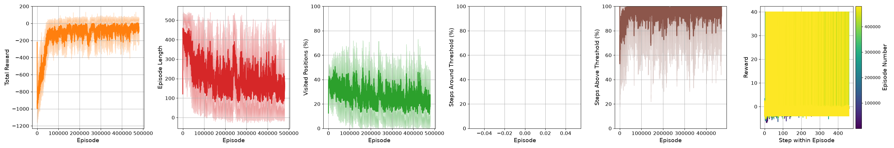
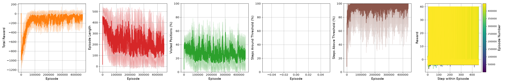
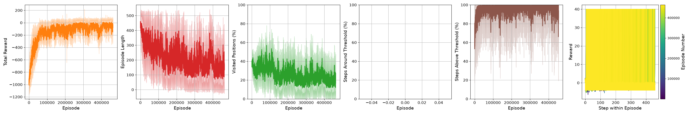

**PPO**

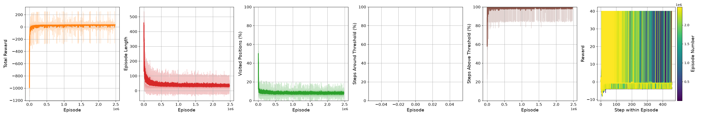
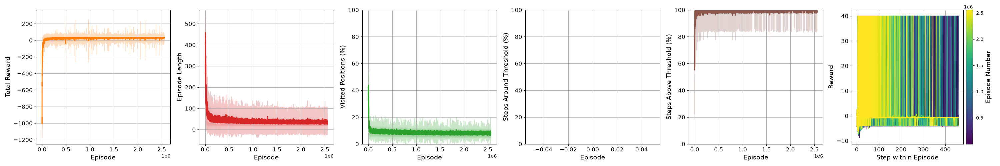
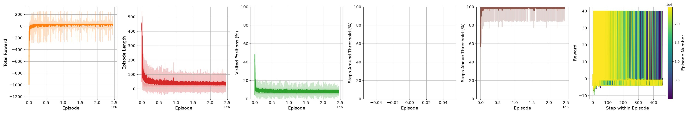

**SAC**

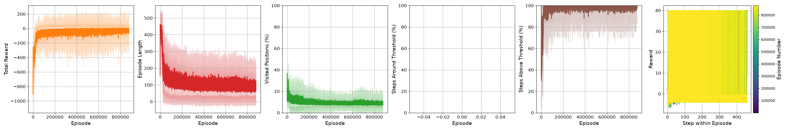
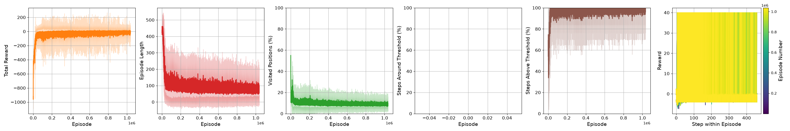
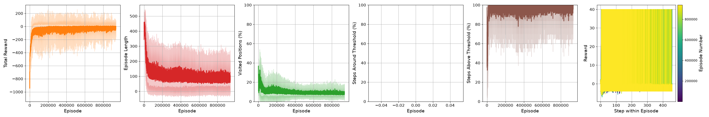

### Observations

- **Spread between repeats:** very small for PPO (the run means of the reward range from 31.6 to 32.7). Larger for SAC (−22.2 to −6.1) and for DQN, where `4259610` has a lower plume coverage (87.3 %) than the other two (95–97 %).
- **DQN:** the reward rises from about −1,000 to about −100 in the first ~100k episodes, then improves slowly to about −65 over the remaining ~350k. The curves stay noisy, with repeated dips in the reward and jumps in the episode length during the whole run. The episode length ends at about 165 steps (std about 150), and 86 % of the episodes end early (37.5 % in run 2). It visits about 24 % of the map, about 3× as much as PPO and SAC.
- **PPO:** the reward reaches about +30 within the first ~0.2M of about 2.5M episodes and then stays flat, while the episode length keeps falling slowly to about 33 steps. All of the last 1,000 episodes end early, with 99.8 % plume coverage and 8 % of the map visited. Most of the training budget was spent after the reward had levelled off.
- **SAC:** as in run 2, the episode length stays near the step limit during the first ~10k–20k episodes, and the plume coverage drops to about 30–35 % in this phase. Then the reward rises fast to about −50 and improves slowly to about −16 at the end. 98 % of the last 1,000 episodes end early (69.6 % in run 2), after about 83 steps with 9 % of the map visited. The episode length stays noisier than PPO's (std about 85, against 16 for PPO).
- **Resume:** `DQN_compare_100M_4259604` shows a dip in the reward and a rise in the episode length near episode 250k, close to where it resumed (episode 247,716). The DQN curves have similar dips elsewhere, so the plots alone do not show whether the empty replay buffer caused it. The SAC plots show no clear change where the runs resumed (episodes 258k–314k).
- **Wall-clock time:** PPO was the fastest, and the only algorithm with a run that finished in one job (20.2 h for 100M steps). In the about 24 h before the failure, the first jobs reached 60–70M steps for DQN and 40–50M for SAC.

## HRL meta agent

From run 4 on, the runs train the meta agent of the HRL setup. The meta agent (PPO) chooses which of three trained sub-agents moves the AUV next, and the chosen sub-agent then runs a few steps (an option). The sub-agents are frozen and act deterministically.

### Settings shared by the HRL runs

- **Script:** [train_HRL(ppo).py](<../HUGIN_gym/training/train_HRL(ppo).py>), submitted with [fox_train_HRL.sh](../fox_train_HRL.sh) as `sbatch fox_train_HRL.sh <tag>`. From run 5 on, the tag also selects the meta agent variant (`PRESETS` in the script). The runs are saved as `../trained-agents/HRL_PPO_<tag>_<job ID>`.
- **Sub-agents:**

  | Sub-agent | Model | Observation keys |
  |---|---|---|
  | Space exploration | `../trained-agents/PPO_space_30M` | `obs_state`, `visited_maps_downsampled`, `space_coverage` |
  | Plume | `../trained-agents/PPO_compare_100M_4259607` (run 3) | `obs_state`, `local_GT`, `plume_coverage`, `space_coverage`, `distance_from_max` |
  | Border | `../trained-agents/PPO_border_4280885` | `obs_state`, `local_GT_around`, `border_coverage`, `space_coverage`, `distance_from_max` |

- **Environment:** the 41 × 41 map of runs 1–3 with one Gaussian source, σ random in [2.0, 5.0]. The AUV starts in a random corner, heading along an edge into the map, like a lawnmower survey (`spawn_at_survey_start`). GP on (RBF, length scale 3.5): the meta agent and the sub-agents only see the GP's estimate of the plume, never the true plume.
- **Survey budget:** 480 AUV steps per episode.
- **Goals:** accuracy goals [0.9, 0.9, 0.9].
- **Meta reward** ([HRL_env.py](../HUGIN_gym/envs/HRL_env.py), [GPWrapper.py](../HUGIN_gym/envs/wrappers/GPWrapper.py)), summed over the steps of an option and discounted by 0.998 per step:
  - −1 per step, plus a reward for new cells that depends on the chosen sub-agent. Space exploration gets (new visited cells) / 6, but only while the plume and border estimates are at least 90 % covered and no new plume or border cells are found. Plume and border get (new border cells + new visited cells) / 6 when they find new border cells, otherwise (new visited cells) / 12.
  - +40 once per plume when the estimated plume and border are both at least 90 % covered.
  - +40 and the episode ends when the mean GP standard deviation over the map is 0.1 or lower and both coverages are at least 90 %.
  - −4 instead of the step reward when the AUV tries to leave the map, and −2 when an option ends after 3 steps without new cells.
- **Meta agent (PPO):** 12 parallel envs, `n_steps` 512, `batch_size` 1024, `n_epochs` 4, `learning_rate` 3e-4, `gae_lambda` 0.95, `clip_range` 0.2, `ent_coef` 0.01, `vf_coef` 0.5, `max_grad_norm` 0.5, hidden layers pi [64, 64] and vf [64, 64] Tanh (SB3 default). `gamma` 0.998 per AUV step, which is 0.998³ ≈ 0.994 per 3-step decision. 10M decisions, with a checkpoint and a stats snapshot every 2,049,996 decisions.
- **Fox:** 16 CPUs, 2 GB per CPU (32 GB). Run 4 made about 106 decisions per second.
- **Counting:** the meta agent's step count, the episode length in the stats and `rollout/ep_len_mean` count meta decisions, not AUV steps.

## Run 4: HRL `untuned` (job 4363368)

- **Goal:** first training of the meta agent, with the settings from the thesis code. It is the baseline for run 5.
- **Submitted with:** `sbatch fox_train_HRL.sh untuned`, resumed twice with `sbatch fox_train_HRL.sh untuned 4363368`.
- **Code:** `56ba1c7` (2026-10-28 14:57), the last commit before the start. Not yet checked on Fox with `git reflog`.
- **Fox resources:** 16 CPUs, 32 GB, 12 h limit.
- **Meta agent:** 3 actions, one per sub-agent, and every option runs 3 steps, so an episode has at most 160 decisions. The meta state is 158 inputs, turned into 128 features (ReLU) by `AgentHRLExplore` ([agent0_HRL.py](../HUGIN_gym/agents/feature_extractor/agent0_HRL.py)): the three coverages, position and heading, 7 × 7 patches of the visited map and of the plume and border estimates, and `distance_from_max`. With the GP on, `distance_from_max` is always 1.0.
- **Status:** running. The third job should finish on 2026-10-30 between about 02:00 and 02:15.

### Time limit and resumes

The 12 h limit was too short for 10M decisions, so the run needed three jobs. Each job lost the decisions after its last checkpoint: about 1 h in the first job and about 1.5 h in the second.

| Job | Started (from decision) | Last checkpoint | Checkpoint written | Speed |
|---|---|---|---|---|
| 4363368 | 2026-10-28 15:13 (0) | 4,099,992 | 2026-10-29 02:16 | about 103 decisions/s |
| First resume | 2026-10-29 08:57 (4,099,992) | 8,199,984 | 2026-10-29 19:24 | about 109 decisions/s |
| Second resume | 2026-10-29 21:22 (8,199,984) | – (the next would be 10,249,980) | – | – |

- "Started" is `RUN_INFO.timestamp` in `training_config.json` and the times in `resume_log.txt`. Both are written after the envs are set up, a few minutes after the Slurm start. `resume_log.txt` also has the job IDs of the resumes.
- 10M decisions take about 26–27 h, so `fox_train_HRL.sh` now asks for 30 h.

### Learning curve so far

From `episode_stats_8199984.pkl` (61,967 episodes up to 8.2M decisions), split into 20 groups of equal size, in order. "Plume coverage" is the true coverage. It is missing for some episodes, so its groups line up only roughly with the decisions.

| Up to decision | Total reward | Episode length (decisions) | Ended early (%) | Visited (%) | Plume coverage (%) |
|---|---|---|---|---|---|
| 449,651 | -376.1 | 145.1 | 49.6 | 79.4 | 88.6 |
| 895,296 | -362.0 | 143.8 | 54.6 | 79.8 | 89.1 |
| 1,325,036 | -332.9 | 138.7 | 60.3 | 81.6 | 89.8 |
| 1,732,379 | -288.1 | 131.4 | 75.7 | 83.5 | 92.1 |
| 2,136,361 | -296.0 | 130.4 | 80.9 | 87.4 | 92.3 |
| 2,542,129 | -304.1 | 130.9 | 78.9 | 87.3 | 92.2 |
| 2,948,584 | -303.9 | 131.2 | 79.3 | 87.3 | 92.0 |
| 3,353,915 | -304.1 | 130.8 | 79.8 | 87.3 | 92.2 |
| 3,761,757 | -306.7 | 131.6 | 77.8 | 87.5 | 92.2 |
| 4,168,793 | -307.6 | 131.4 | 78.0 | 87.2 | 91.9 |
| 4,576,638 | -310.7 | 131.6 | 76.9 | 87.3 | 92.0 |
| 4,980,678 | -302.4 | 130.4 | 79.7 | 87.1 | 92.3 |
| 5,387,546 | -307.7 | 131.3 | 77.5 | 87.0 | 92.0 |
| 5,799,114 | -313.7 | 132.8 | 71.7 | 85.9 | 91.3 |
| 6,210,692 | -277.0 | 132.9 | 70.7 | 80.2 | 92.0 |
| 6,617,401 | -246.5 | 131.3 | 75.8 | 78.1 | 93.4 |
| 7,019,434 | -231.7 | 129.8 | 77.9 | 78.0 | 94.6 |
| 7,417,298 | -219.6 | 128.4 | 79.3 | 77.9 | 95.2 |
| 7,809,406 | -202.5 | 126.6 | 82.0 | 77.9 | 95.3 |
| 8,198,391 | -193.8 | 125.6 | 83.8 | 77.3 | 95.6 |

"Ended early" means the episode reached the termination goal before the limit of 160 decisions.

### Observations so far

- **Three phases:**
  - Up to about 2M decisions, fast improvement: the reward goes from −376 to −296, and the share that ends early from 50 % to 81 %.
  - From 2M to 5.8M, flat at about −305.
  - From about 5.8M, a second improvement that is still going at 8.2M: the reward goes from −314 to −194, ended early from 72 % to 84 %, and the plume coverage from 92 % to 95.6 %.
- **Less of the map visited:** in the second improvement the visited share drops from 87 % to 77 %. The agent reaches the termination goal with less of the map visited.
- **Run length:** a run of 5M decisions would have stopped in the flat phase. Run 5 therefore also uses 10M decisions.
- **Resume:** the second improvement starts at about 5.8M, not at the resume at 4.1M.
- **Results after 10M decisions:** to be added when the run has finished.

## Run 5: HRL meta agent variants

- **Goal:** test two questions from the project supervisor.
  1. Can the meta agent learn how long to use a sub-agent in different situations? It chooses between a 2-step and a 5-step variant of each sub-agent. We hope to see it choose the 5-step space exploration early in the survey.
  2. How little information does the meta agent need? The meta state goes from 158 inputs to 6 numbers, with and without each sub-agent's own estimate of how well it will do.
- **Submitted with:**

  ```bash
  sbatch fox_train_HRL.sh minimal
  sbatch fox_train_HRL.sh minimal_values
  sbatch --time=2-06:00:00 fox_train_HRL.sh duration
  sbatch --time=2-06:00:00 fox_train_HRL.sh duration_mean
  sbatch --time=2-06:00:00 fox_train_HRL.sh minimal_values_duration
  ```

- **Code:** not committed yet. Note the commit at submission.
- **Fox resources:** 16 CPUs, 32 GB per run. 30 h limit for the 3-step variants. 54 h for the duration variants, because their 10M decisions can be up to 50M AUV steps.
- **Status:** not submitted yet.

### The variants

| Tag | Actions | Reward per decision | Discount per decision | Cost per decision | Meta state |
|---|---|---|---|---|---|
| `untuned` (run 4) | 3 sub-agents × 3 steps | Sum of the step rewards | 0.998³ | 0 | Full (158 inputs) |
| `duration` | 3 sub-agents × {2, 5} steps | Sum | 0.998^k, k = steps run | 0.1 | Full |
| `duration_mean` | 3 sub-agents × {2, 5} steps | Mean of the step rewards; bonuses and penalties in full | 0.998³ | 0.1 | Full |
| `minimal` | 3 sub-agents × 3 steps | Sum | 0.998³ | 0 | Minimal (6 numbers) |
| `minimal_values` | 3 sub-agents × 3 steps | Sum | 0.998³ | 0 | Minimal + 3 sub-agent values |
| `minimal_values_duration` | 3 sub-agents × {2, 5} steps | Sum | 0.998^k | 0.1 | Minimal + 3 sub-agent values |

Each comparison changes one thing:

| Compare | To see the effect of |
|---|---|
| `duration` with `untuned` | Choosing the option length |
| `duration_mean` with `duration` | The mean reward suggested by the supervisor, against the sum with a discount per decision |
| `minimal` with `untuned` | The small meta state |
| `minimal_values` with `minimal` | The sub-agent values |
| `minimal_values_duration` with `minimal_values` and `duration` | Both ideas together |

### Choosing the option length (`duration`, `duration_mean`, `minimal_values_duration`)

- **Actions:** 6, one per sub-agent and length: `space_2`, `space_5`, `plume_2`, `plume_5`, `border_2`, `border_5`. An option still ends after 3 steps without new cells (−2), so a 5-step option can stop after 3 steps.
- **Survey budget in AUV steps:** the episode ends after 480 AUV steps, not after a number of decisions. Otherwise the 5-step variants would give a longer survey, and the agent would prefer them for that reason alone. The decision limit is 240 (480 / 2), so it never ends an episode first.
- **Sum and discount per decision (`duration`, `minimal_values_duration`):** a 5-step decision covers more time than a 2-step decision. Its step rewards are summed, and the next decision is discounted by 0.998⁵ instead of 0.998². This is the semi-MDP form of the options framework (Sutton, Precup and Singh, 1999). A 2-step and a 5-step choice are then compared over the same time, and the reward scale favors neither.
  - SB3's PPO uses one discount for every step. These runs use `SMDPDictRolloutBuffer` ([smdp_rollout_buffer.py](../HUGIN_gym/agents/smdp_rollout_buffer.py)), which gets the discount of each decision from the env through `SMDPDiscountCallback`.
  - One small approximation remains. When an episode hits the step limit, SB3 bootstraps it with 0.998³ instead of the last decision's own discount. The difference is below 1 %.
- **Cost per decision (0.1):** this is the "slightly higher reward for the variant with more actions". A 5-step option makes fewer decisions, so it pays less cost per AUV step. 0.1 is 10 % of the time penalty of one step. Harb et al. (2018) call this a deliberation cost.
- **Mean reward (`duration_mean`):** the supervisor's suggestion. The step rewards are averaged over the option, so that the 5-step variant does not win by adding up more rewards. The bonuses and penalties count in full, and every decision has the same discount, 0.998³.
  - The episode's return is still a sum over decisions, and long options make fewer decisions.
  - When the step rewards are mostly negative, fewer decisions give a less negative return, whatever the situation. In run 4 the reward averages about −0.5 per AUV step (−194 per episode of about 377 steps at 8.2M).
  - We therefore expect `duration_mean` to choose the 5-step variants more often than `duration`. The run tests this.
- **Related methods:** choosing an action together with how long to repeat it is also used in Dynamic Action Repetition (Lakshminarayanan, Sharma and Ravindran, 2017) and FiGAR (Sharma, Lakshminarayanan and Ravindran, 2017).

### Minimal meta states (`minimal`, `minimal_values`, `minimal_values_duration`)

| Input | Meaning |
|---|---|
| `time_used` | Share of the 480-step survey used |
| `space_coverage` | Share of the map visited |
| `plume_coverage` | Share of the estimated plume visited |
| `border_coverage` | Share of the estimated plume border visited |
| `plume_found` | 1 when the GP estimate holds a plume, otherwise 0 |
| `gp_uncertainty` | Mean GP standard deviation over the map. The termination goal needs 0.1 or lower |

- **Why `plume_found`:** before a plume is found, the plume and border estimates only hold the four corner cells, which count as visited. The coverages then show 1.0, the same value as a fully covered plume.
- **Why `time_used`:** the run 4 meta state has no time input, although the episodes have a fixed limit.
- **Sub-agent values (`minimal_values`, `minimal_values_duration`):** each sub-agent's own PPO critic estimates its expected return if it is chosen now. The three values are scaled with symlog, sign(v) · log(1 + |v|), because the sub-agents have different reward scales. The critics learned in the sub-agents' own training situations, for example the plume agent always started near the plume. So the values may be off in a full survey, which these runs also show.
- **Network:** SB3's default for dict observations, which concatenates the inputs, followed by [64, 64] Tanh. `AgentHRLExplore` is not used.
- **Expected effect:** fewer decisions needed to learn, not faster decisions. Most of the time per decision most likely goes to the GP update after every AUV step and to the three sub-agents, not to the meta network. This has not been profiled.

### Changes for all HRL runs from run 5 on

| Change | Why |
|---|---|
| The tag selects the variant (`--preset`) | One job script for all variants |
| The survey budget is counted in AUV steps (480) | Needed for the duration variants. For 3-step options it ends the episode at 160 decisions, as in run 4 |
| `VecMonitor` | `rollout/ep_rew_mean` and `rollout/ep_len_mean` in TensorBoard |
| `OptionUsageCallback` ([OptionUsageCallback.py](../HUGIN_gym/callbacks/OptionUsageCallback.py)) | The meta agent's choices per survey phase in TensorBoard |
| `HRL_VARIANT` in `training_config.json` | Records the variant settings |
| 30 h limit in `fox_train_HRL.sh` (was 12 h) | 10M decisions take about 27 h |

### How to compare the variants

- **TensorBoard** (`tensorboard --logdir ../trained-agents`), logged once per PPO update:

  | Tag | Meaning |
  |---|---|
  | `hrl_choice_early/<action>`, `hrl_choice_middle/<action>`, `hrl_choice_late/<action>` | Share of the decisions in the first, middle and last third of the survey that chose the action |
  | `hrl/option_length` | Mean AUV steps per decision |
  | `hrl/episode_steps` | Mean AUV steps of the episodes that ended during the update |
  | `hrl/ended_early` | Share of those episodes that reached the termination goal |
  | `rollout/ep_rew_mean`, `rollout/ep_len_mean` | Mean reward and decisions of the last 100 episodes |

- **Do not compare the reward between variants.** The cost per decision and the mean reward change its scale. Compare `hrl/ended_early`, `hrl/episode_steps`, and the visited and plume coverage from the stats.
- **Episode length:** it counts decisions, and in the duration variants a decision is 2–5 AUV steps, so use `hrl/episode_steps`. For the same reason, "Ended early" from `summarise_training_stats.py` (length below the decision limit) is wrong for the duration variants. Use `hrl/ended_early`.
- **The x-axis in TensorBoard counts decisions.** The duration variants make fewer decisions per AUV step, and `hrl/option_length` converts between the two.
- **One run per variant:** a difference smaller than the spread between repeats cannot be trusted. Repeat the promising variants with 2–3 runs.
- **Do not stop a run because its curve is flat.** Run 4 was flat for almost 4M decisions before it improved again.

### Results

To be added when the runs have finished.

### References

- Harb, J., Bacon, P.-L., Klissarov, M. and Precup, D. (2018). When waiting is not an option: learning options with a deliberation cost. *AAAI Conference on Artificial Intelligence*.
- Lakshminarayanan, A. S., Sharma, S. and Ravindran, B. (2017). Dynamic action repetition for deep reinforcement learning. *AAAI Conference on Artificial Intelligence*.
- Sharma, S., Lakshminarayanan, A. S. and Ravindran, B. (2017). Learning to repeat: fine grained action repetition for deep reinforcement learning. *International Conference on Learning Representations (ICLR)*.
- Sutton, R. S., Precup, D. and Singh, S. (1999). Between MDPs and semi-MDPs: a framework for temporal abstraction in reinforcement learning. *Artificial Intelligence*, 112(1–2), 181–211.

## Adding a new run

1. Before submitting: commit the changes and note the commit. Submit with `sbatch fox_train.sh <tag>` (HRL: `sbatch fox_train_HRL.sh <tag>`) and note the job ID(s).
2. Add a row to the overview table and a section with the goal, what changed (with commits and why), the settings tables and the Fox resources.
3. If a job fails: find the cause in `slurm-hugin-plume-<job ID>_<array index>.out` on Fox (HRL: `slurm-hugin-hrl-<job ID>.out`). Resume the runs from their newest checkpoint with `sbatch fox_train.sh <tag> <job ID>` (add `--array=...` to resume only some algorithms) and note the resume job IDs. Get the start, end and elapsed times with `sacct -j <job IDs> --format=JobID,Start,End,Elapsed,State`.
4. After downloading: make the plot with [training_data_visualiser.py](../HUGIN_gym/evaluation/training_data_visualiser.py). Copy `training_stats.png`, `training_config.json` and, for a resumed run, `resume_log.txt` to `docs/training_runs/<run>/`. Run [summarise_training_stats.py](../HUGIN_gym/evaluation/summarise_training_stats.py) for the numbers table.
5. Write down what the curves and the numbers show.
